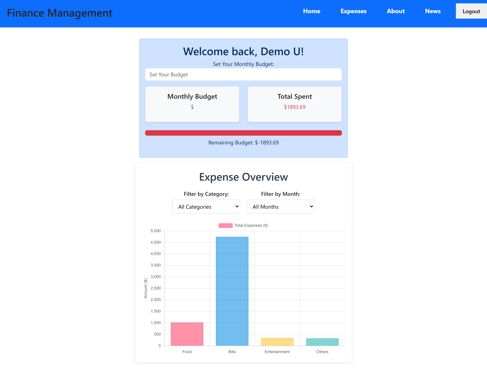
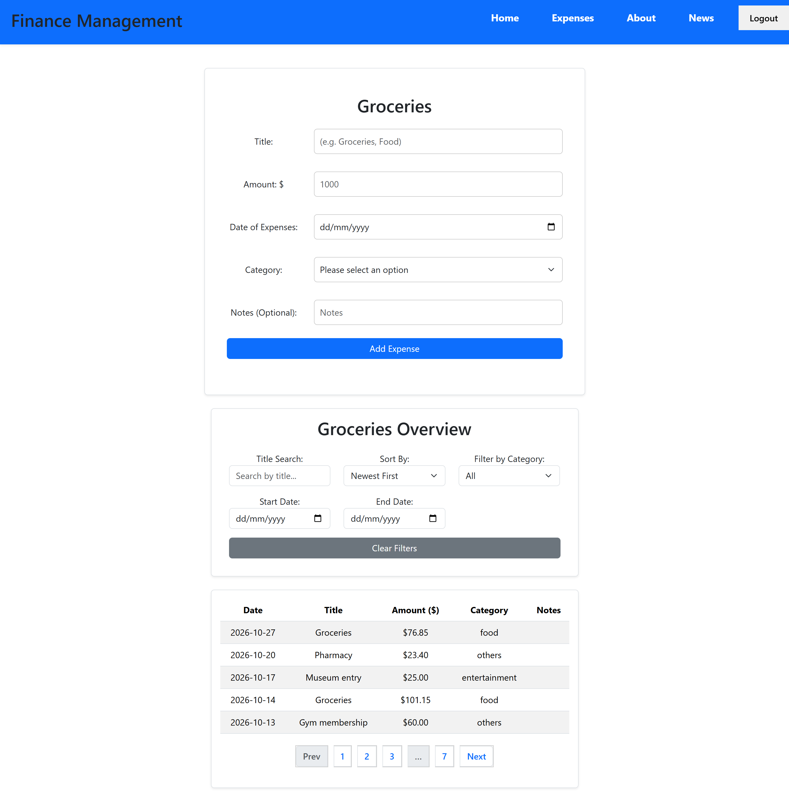

# Finance Tracker

A personal finance web app for recording expenses, filtering and visualising them, and
tracking spending against a monthly budget. Originally a university project that only ran
on the campus server; rebuilt to run anywhere, with the security issues fixed and a
containerised deploy on Render + Aiven.

**Live demo:** https://finance-tracker-hupw.onrender.com
**Demo login:** `demo@example.com` / `Demo-Pass-2026`

> The demo runs on a free tier, so the first request after it has been idle can take up to
> a minute to wake up.

## Screenshots

<!-- Add screenshots here, e.g. the dashboard, the expenses list with filters, and a chart.
     Put the images in a docs/ folder and reference them:

 -->

## Features

- Email/password accounts with server-side sessions
- Add, edit and delete expenses (title, amount, date, category, notes)
- Filter by category and date range, search by title, and sort by date or amount
- Server-side pagination
- Monthly budget tracking with a spent-vs-budget view
- Spending visualisation by category (Chart.js)

## Tech stack

| Layer    | Tech                                              |
|----------|---------------------------------------------------|
| Frontend | Vue 3 (Options API), Vite, Vue Router, Chart.js, Bootstrap |
| Backend  | PHP 8.3 (Apache), mysqli, PHP sessions            |
| Database | MySQL 8.4                                         |
| Deploy   | Docker, Render (app), Aiven (managed MySQL, TLS)  |

The frontend talks to the API through a single axios instance; the API base URL comes from
`VITE_API_URL` (defaults to `/api`). In production the built site and the PHP API are served
from the same origin, so the session cookie is sent with every request.

## Run locally

Requirements: Docker Desktop and Node.js 20+.

```bash
# 1. Start MySQL + the PHP API (schema and demo data load automatically)
docker compose up -d

# 2. Install frontend dependencies and start the dev server
npm install
npm run dev
```

Open http://localhost:5173. Vite proxies `/api` to the PHP container on port 8000.

The database init scripts (`db/schema.sql`, `db/seed.sql`) only run on an empty volume.
To reset the database:

```bash
docker compose down -v && docker compose up -d
```

## Configuration

The API reads its database settings from environment variables:

| Variable        | Purpose                                             |
|-----------------|-----------------------------------------------------|
| `DB_HOST`       | database host                                       |
| `DB_PORT`       | database port (defaults to 3306)                    |
| `DB_USER`       | database user                                        |
| `DB_PASSWORD`   | database password                                    |
| `DB_NAME`       | database name                                        |
| `DB_SSL_CA_PEM` | CA certificate contents for TLS (production only)   |

Locally these are set in `docker-compose.yml`; TLS is off because the local MySQL doesn't
use it. In production `DB_SSL_CA_PEM` is set, which turns TLS on.

## Deployment

**Database — Aiven (managed MySQL):**
1. Create a free MySQL service and note the host, port, user, password and database.
2. Load `db/schema.sql` then `db/seed.sql` over TLS.

**App — Render (Docker web service):**
1. Connect the repo as a Docker web service; it builds the Dockerfile's final `prod` stage
   (Vue is built, then copied alongside the PHP API into one Apache image).
2. Set `DB_HOST`, `DB_PORT`, `DB_USER`, `DB_PASSWORD`, `DB_NAME`, and `DB_SSL_CA_PEM`
   (the Aiven CA certificate contents).

Aiven requires TLS, and its CA certificate is public, so it is passed as an environment
variable and written to a file at runtime — rather than a secret file, which the web-server
user can't read on Render.

## What I changed from the university version

The original ran only on the campus server and had a number of problems. The commit history
walks through each fix, one per commit:

**Removed the platform lock-in**
- Replaced hardcoded campus URLs and base paths with environment-based config, so it runs
  anywhere.

**Fixed the security issues**
- Passwords are now bcrypt hashes (`password_hash` / `password_verify`) instead of plain text.
- The password hash is no longer returned to the browser; the session stores only the user id.
- Closed a SQL injection in the `sortBy` parameter by allow-listing column names.
- Every data endpoint now requires a valid session; protected routes are guarded on the
  frontend too.
- Added server-side validation (email, password rules, amount, category, date) and a clear
  duplicate-email message.
- Database errors are logged on the server and returned to the client as a generic message.
- Login returns one message for both an unknown email and a wrong password, so it no longer
  reveals which emails are registered.

**Made it deployable**
- Added a MySQL schema and demo seed data.
- Containerised the whole stack (multi-stage Dockerfile + docker-compose for local dev).
- Deployed on Render with the database on Aiven over TLS.

## Project structure

```
api/            PHP endpoints; bootstrap.php sets up sessions, JSON and helpers
db/             schema.sql and seed.sql
src/            Vue app (components, router, shared axios client)
public/         static assets and the SPA fallback (.htaccess)
Dockerfile      builds Vue, then serves the build + API from PHP/Apache
docker-compose.yml   local MySQL + PHP
```
